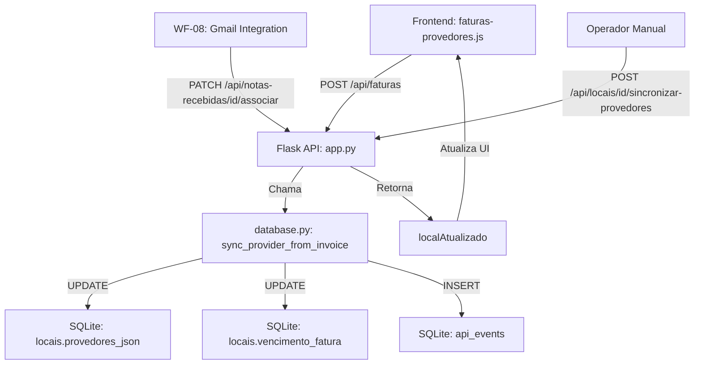

# Design Document: Sincronização de Dados de Provedor entre Fatura e Local

## Overview

Este design implementa a sincronização automática de dados de provedor (valor, dataVencimento, diaVencimento) entre as faturas PDF e os registros de Locais no banco de dados SQLite. A sincronização ocorre em dois fluxos principais:

1. **Fluxo Manual**: Upload de fatura pela aba Faturas (`POST /api/faturas`)
2. **Fluxo Gmail**: Associação de nota recebida (`PATCH /api/notas-recebidas/{id}/associar`)

A sincronização elimina a dependência do `localStorage` do navegador para propagação de dados de fatura, garantindo que o backend (cards, alertas, painel SIG) sempre possua os dados mais recentes dos provedores.

### Objetivos

- Atualizar automaticamente os campos `valor`, `dataVencimento` e `diaVencimento` do provedor no Local quando uma fatura é salva ou associada
- Recalcular o campo `vencimentoFatura` do Local como o menor vencimento entre todos os provedores
- Identificar provedores por nome normalizado (sem acentos, case-insensitive)
- Criar novos registros de provedor quando não existirem no Local
- Manter idempotência para evitar atualizações desnecessárias
- Fornecer endpoint manual para reconciliação retroativa de dados históricos
- Registrar todas as sincronizações em log de eventos para auditoria

---

## Architecture

### Componentes



### Fluxo de Dados

#### Fluxo Manual (Upload de Fatura)

1. Usuário seleciona PDF na aba Faturas
2. `faturas-provedores.js` envia POST para `/api/faturas` com form-data (PDF + metadados)
3. Backend extrai dados via OCR (se necessário)
4. Backend salva registro em `faturas_locais`
5. **[NOVO]** Backend invoca `sync_provider_from_invoice()`
6. `sync_provider_from_invoice()` normaliza nome do emissor e busca provedor no Local
7. Atualiza ou cria provedor em `provedores_json`
8. Recalcula `vencimento_fatura` do Local
9. Registra evento `provedor_sincronizado`
10. Backend retorna resposta com `localAtualizado`
11. Frontend atualiza UI usando `localAtualizado`

#### Fluxo Gmail (Associação Automática)

1. WF-08 envia nota recebida do Gmail
2. Backend salva em `notas_recebidas`
3. Operador ou automação chama `PATCH /api/notas-recebidas/{id}/associar`
4. Backend cria/atualiza registro em `faturas_locais`
5. **[NOVO]** Backend invoca `sync_provider_from_invoice()`
6. Mesmos passos 6-9 do fluxo manual
7. Backend retorna resposta com `localAtualizado`

#### Fluxo de Reconciliação Retroativa

1. Operador chama `POST /api/locais/{local_id}/sincronizar-provedores`
2. Backend busca todas as faturas mais recentes por provedor para o Local
3. Para cada fatura, invoca `sync_provider_from_invoice()`
4. Registra evento `sincronizacao_retroativa`
5. Retorna contagem de provedores sincronizados

---

## Components and Interfaces

### 1. database.py: sync_provider_from_invoice()

**Responsabilidade**: Função central de sincronização que atualiza os dados do provedor no Local com base nos dados da fatura.

```python
def sync_provider_from_invoice(
    local_id: str,
    emissor_nome: str,
    valor_total: float,
    data_vencimento: str,
    origem: str = "fluxo_manual"
) -> Dict[str, Any]:
    """
    Sincroniza os dados de um provedor no Local com base nos dados da fatura.
    
    Args:
        local_id: ID do Local (ex: "local-abc123")
        emissor_nome: Nome do provedor/emissor da fatura
        valor_total: Valor total da fatura (em reais)
        data_vencimento: Data de vencimento no formato AAAA-MM-DD
        origem: "fluxo_manual" ou "fluxo_gmail"
    
    Returns:
        Dict contendo o objeto Local atualizado
    
    Raises:
        ValueError: Se local_id não existir ou dados inválidos
    """
```

**Algoritmo**:

1. **Validar entrada**: Verificar que `local_id` existe, `emissor_nome` não está vazio
2. **Buscar Local**: `SELECT * FROM locais WHERE id = ?`
3. **Deserializar provedores**: `provedores = json.loads(provedores_json)`
4. **Normalizar nome do emissor**: `normalized_emissor = _normalize_provider_name(emissor_nome)`
5. **Buscar provedor existente**: Iterar por `provedores` e comparar nomes normalizados
6. **Verificar idempotência**: Se provedor existe e valores idênticos (diferença < 0.01), retornar sem alterações
7. **Atualizar ou criar provedor**:
   - Se existe: Atualizar `valor`, `dataVencimento`, `diaVencimento`
   - Se não existe: Criar novo com `id` (UUID), `nome` (original), campos extraídos
8. **Calcular diaVencimento**: `int(data_vencimento.split('-')[2])` se data válida
9. **Recalcular vencimentoFatura**: Obter mínimo de `dataVencimento` entre provedores com data válida
10. **Serializar provedores**: `provedores_json = json.dumps(provedores)`
11. **Persistir no banco**: `UPDATE locais SET provedores_json = ?, vencimento_fatura = ?, updated_at = ? WHERE id = ?`
12. **Registrar evento**: `log_event("provedor_sincronizado", {...})`
13. **Retornar Local atualizado**: Chamar `get_local(local_id)`

**Estrutura do provedor no array**:

```python
{
    "id": str,                    # UUID único
    "nome": str,                  # Nome do provedor (preservado do cadastro)
    "valor": float,               # Valor da última fatura
    "dataVencimento": str,        # AAAA-MM-DD
    "diaVencimento": int,         # 1-31
    "pagoAte": str,               # AAAA-MM-DD (não modificado pela sincronização)
    "faturaAtualId": str          # ID da última fatura (opcional)
}
```

### 2. app.py: Modificação de POST /api/faturas

**Responsabilidade**: Endpoint existente para upload manual de faturas. Será modificado para invocar sincronização após salvar a fatura.

**Modificações**:

```python
@app.post("/api/faturas")
def upload_fatura_local():
    # ... código existente de extração e salvamento ...
    
    saved = save_fatura_local(
        fatura_id=fatura_id,
        entidade_tipo=entidade_tipo,
        entidade_id=entidade_id,
        provedor_id=provedor_id,
        provedor_nome=provedor_nome,
        nota_lancada_id=nota_lancada_id,
        nome_arquivo=safe_filename,
        arquivo_storage=storage_filename,
        dados={
            "emissorNome": emissor_nome,
            "valorTotal": valor_total,
            "dataVencimento": data_vencimento,
            # ... outros campos ...
        }
    )
    
    # ===== NOVO: Sincronização de provedor =====
    local_atualizado = None
    try:
        local_atualizado = sync_provider_from_invoice(
            local_id=entidade_id,
            emissor_nome=emissor_nome,
            valor_total=valor_total,
            data_vencimento=data_vencimento,
            origem="fluxo_manual"
        )
    except Exception as exc:
        app.logger.error(f"Erro ao sincronizar provedor: {exc}")
        # Não falhar a operação de salvamento
    # ==========================================
    
    return jsonify({
        "ok": True,
        "fatura": saved,
        "localAtualizado": local_atualizado  # NOVO campo
    })
```

### 3. app.py: Modificação de PATCH /api/notas-recebidas/{id}/associar

**Responsabilidade**: Endpoint existente para associar nota recebida do Gmail a um Local. Será modificado para invocar sincronização após criar/atualizar fatura.

**Modificações**:

```python
@app.patch("/api/notas-recebidas/<nota_id>/associar")
def associar_nota_recebida(nota_id: str):
    # ... código existente de validação e associação ...
    
    # Após salvar/atualizar a fatura_local
    fatura = get_fatura_local(fatura_id)
    
    # ===== NOVO: Sincronização de provedor =====
    local_atualizado = None
    try:
        dados = fatura.get("dados", {})
        emissor_nome = dados.get("emissorNome", "")
        valor_total = float(dados.get("valorTotal", 0))
        data_vencimento = dados.get("dataVencimento", "")
        
        if emissor_nome and data_vencimento:
            local_atualizado = sync_provider_from_invoice(
                local_id=entidade_id,
                emissor_nome=emissor_nome,
                valor_total=valor_total,
                data_vencimento=data_vencimento,
                origem="fluxo_gmail"
            )
    except Exception as exc:
        app.logger.error(f"Erro ao sincronizar provedor no fluxo Gmail: {exc}")
        # Não falhar a operação de associação já confirmada
    # ==========================================
    
    return jsonify({
        "ok": True,
        "notaRecebida": updated_nota,
        "fatura": fatura,
        "localAtualizado": local_atualizado  # NOVO campo
    })
```

### 4. app.py: Novo endpoint POST /api/locais/{id}/sincronizar-provedores

**Responsabilidade**: Endpoint para reconciliação retroativa de dados históricos de provedores.

```python
@app.post("/api/locais/<local_id>/sincronizar-provedores")
def sincronizar_provedores_retroativo(local_id: str):
    """
    Sincroniza provedores de um Local com base nas faturas mais recentes.
    Útil para reconciliação retroativa após migração ou correção de dados.
    """
    local = get_local(local_id)
    if not local:
        return jsonify({"ok": False, "error": "Local não encontrado."}), 404
    
    # Buscar faturas mais recentes por provedor
    faturas = list_faturas_locais(
        entidade_tipo=local["tipo"],
        entidade_id=local_id
    )
    
    # Agrupar por provedor normalizado e pegar a mais recente
    provedores_faturas = {}
    for fatura in faturas:
        dados = fatura.get("dados", {})
        emissor = dados.get("emissorNome", "")
        if not emissor:
            continue
        
        normalized = _normalize_provider_name(emissor)
        if normalized not in provedores_faturas:
            provedores_faturas[normalized] = fatura
        else:
            # Comparar datas para pegar a mais recente
            current_date = provedores_faturas[normalized].get("created_at", "")
            new_date = fatura.get("created_at", "")
            if new_date > current_date:
                provedores_faturas[normalized] = fatura
    
    # Sincronizar cada provedor
    count = 0
    for fatura in provedores_faturas.values():
        dados = fatura.get("dados", {})
        try:
            sync_provider_from_invoice(
                local_id=local_id,
                emissor_nome=dados.get("emissorNome", ""),
                valor_total=float(dados.get("valorTotal", 0)),
                data_vencimento=dados.get("dataVencimento", ""),
                origem="sincronizacao_retroativa"
            )
            count += 1
        except Exception as exc:
            app.logger.error(f"Erro ao sincronizar provedor {dados.get('emissorNome')}: {exc}")
    
    # Registrar evento
    log_event("sincronizacao_retroativa", {
        "localId": local_id,
        "provedoresSincronizados": count
    })
    
    # Buscar Local atualizado
    local_atualizado = get_local(local_id)
    
    return jsonify({
        "ok": True,
        "localAtualizado": local_atualizado,
        "provedoresSincronizados": count
    })
```

### 5. faturas-provedores.js: Atualização do Frontend

**Responsabilidade**: Módulo JavaScript que gerencia o upload de faturas. Será modificado para consumir e aplicar o campo `localAtualizado` da resposta.

**Modificações no método `save()`**:

```javascript
async function save() {
  // ... código existente de preparação e envio ...
  
  const response = await fetch(`${backendUrl()}/api/faturas`, {
    method: 'POST',
    headers: { 'X-API-Key': apiKey },
    body: formData,
  });
  
  const result = await response.json();
  
  if (!response.ok) {
    // ... tratamento de erro existente ...
    return;
  }
  
  // ===== NOVO: Aplicar localAtualizado =====
  if (result.localAtualizado) {
    // Atualizar estado em memória do Local
    // Isso substitui a escrita anterior no localStorage para provedores
    const localAtualizado = result.localAtualizado;
    
    // Se houver callback registrado (agencias.html), notificar
    if (onSaved && typeof onSaved === 'function') {
      onSaved(result.fatura, localAtualizado);
    }
    
    // Disparar evento customizado para re-renderização
    window.dispatchEvent(new CustomEvent('sigp:local-updated', {
      detail: { local: localAtualizado }
    }));
  }
  // ==========================================
  
  setBusy(false, 'Fatura salva com sucesso.');
  close();
}
```

**Modificações em agencias.html** (consumidor do módulo):

```javascript
// Listener do evento de atualização de Local
window.addEventListener('sigp:local-updated', (event) => {
  const localAtualizado = event.detail.local;
  
  // Atualizar card do Local na UI
  const card = document.querySelector(`[data-local-id="${localAtualizado.id}"]`);
  if (card) {
    renderLocalCard(card, localAtualizado);
  }
  
  // Atualizar cache global de locais
  const index = storedLocais.findIndex(l => l.id === localAtualizado.id);
  if (index >= 0) {
    storedLocais[index] = localAtualizado;
  }
});
```

---

## Data Models

### Tabela: locais

```sql
CREATE TABLE locais (
    id TEXT PRIMARY KEY,
    tipo TEXT NOT NULL,                      -- "agencia" | "rodoviaria" | "garagem"
    nome TEXT NOT NULL DEFAULT '',
    cidade TEXT NOT NULL DEFAULT '',
    endereco TEXT NOT NULL DEFAULT '',
    vencimento_fatura TEXT NOT NULL DEFAULT '',  -- AAAA-MM-DD (menor vencimento entre provedores)
    provedores_json TEXT NOT NULL DEFAULT '[]',  -- Array JSON de provedores
    dados_json TEXT NOT NULL DEFAULT '{}',
    ativo INTEGER NOT NULL DEFAULT 1,
    created_at TEXT NOT NULL,
    updated_at TEXT NOT NULL
);
```

### Estrutura de provedores_json

```json
[
  {
    "id": "prov-abc123",
    "nome": "Vivo Empresas",
    "valor": 450.00,
    "dataVencimento": "2025-02-15",
    "diaVencimento": 15,
    "pagoAte": "2025-01-15",
    "faturaAtualId": "fatura-xyz789"
  },
  {
    "id": "prov-def456",
    "nome": "Claro Net",
    "valor": 320.50,
    "dataVencimento": "2025-02-10",
    "diaVencimento": 10,
    "pagoAte": "",
    "faturaAtualId": ""
  }
]
```

### Tabela: faturas_locais

```sql
CREATE TABLE faturas_locais (
    id TEXT PRIMARY KEY,
    entidade_tipo TEXT NOT NULL,
    entidade_id TEXT NOT NULL,
    provedor_id TEXT NOT NULL DEFAULT '',
    provedor_nome TEXT NOT NULL DEFAULT '',
    nota_lancada_id TEXT NOT NULL DEFAULT '',
    nome_arquivo TEXT NOT NULL,
    arquivo_storage TEXT NOT NULL,
    dados_json TEXT NOT NULL,              -- JSON com emissorNome, valorTotal, dataVencimento, etc.
    created_at TEXT NOT NULL,
    updated_at TEXT NOT NULL
);
```

### Tabela: api_events

```sql
CREATE TABLE api_events (
    id INTEGER PRIMARY KEY AUTOINCREMENT,
    tipo TEXT,                              -- "provedor_sincronizado" | "sincronizacao_retroativa"
    payload TEXT,                           -- JSON com detalhes do evento
    created_at TEXT
);
```

### Estrutura do evento provedor_sincronizado

```json
{
  "localId": "local-abc123",
  "localTipo": "agencia",
  "provedorNome": "Vivo Empresas",
  "valorAnterior": 400.00,
  "valorNovo": 450.00,
  "dataVencimentoAnterior": "2025-01-15",
  "dataVencimentoNovo": "2025-02-15",
  "origem": "fluxo_manual"
}
```

### Estrutura do evento sincronizacao_retroativa

```json
{
  "localId": "local-abc123",
  "provedoresSincronizados": 3
}
```

---

## Correctness Properties

*A property is a characteristic or behavior that should hold true across all valid executions of a system—essentially, a formal statement about what the system should do. Properties serve as the bridge between human-readable specifications and machine-verifiable correctness guarantees.*

**Observação sobre Aplicabilidade de PBT**: Esta feature envolve principalmente operações de integração com banco de dados, APIs e persistência de estado. Property-based testing é mais apropriado para a lógica pura de transformação de dados (normalização de nomes, cálculo de datas). As operações de I/O e integração com SQLite são mais adequadas para testes de integração com exemplos específicos.

### Property 1: Sincronização de campos do provedor

*Para qualquer* Local válido e fatura válida com emissorNome correspondente a um provedor no Local, após a sincronização o provedor deverá ter `valor` igual ao `valorTotal` da fatura, `dataVencimento` igual ao `dataVencimento` da fatura, e `diaVencimento` derivado corretamente como o dia do mês da data de vencimento.

**Validates: Requirements 1.2, 1.3, 1.4**

### Property 2: Normalização de nome identifica provedor corretamente

*Para quaisquer* dois nomes de provedor que diferem apenas em acentuação, capitalização ou caracteres não-alfanuméricos, a função de normalização deve produzir a mesma chave, permitindo a identificação correta do provedor existente no Local.

**Validates: Requirements 2.1**

### Property 3: Provedor é criado ou atualizado sem duplicação

*Para qualquer* Local e fatura, se existir um provedor com nome normalizado equivalente ao emissor, a sincronização deve atualizar esse provedor sem aumentar o tamanho do array de provedores; se não existir, deve criar um novo provedor com UUID único e aumentar o tamanho do array em exatamente 1.

**Validates: Requirements 2.2, 2.3, 2.5**

### Property 4: Nome cadastrado do provedor é preservado

*Para qualquer* provedor existente com campo `nome` preenchido, a sincronização de uma fatura com `emissorNome` diferente (mas normalizado equivalente) não deve alterar o campo `nome` do provedor.

**Validates: Requirements 2.4**

### Property 5: vencimentoFatura reflete menor vencimento válido

*Para qualquer* Local com múltiplos provedores, após qualquer sincronização o campo `vencimentoFatura` do Local deve ser igual ao menor valor de `dataVencimento` entre todos os provedores cujo `dataVencimento` seja uma data válida no formato AAAA-MM-DD.

**Validates: Requirements 1.5, 5.1**

### Property 6: Sincronização é idempotente

*Para qualquer* Local e provedor, se uma fatura for sincronizada duas vezes consecutivas com os mesmos valores de `valorTotal` e `dataVencimento` (diferença de valor menor que R$ 0,01), a segunda sincronização não deve alterar o campo `updated_at` do Local nem registrar evento de log.

**Validates: Requirements 4.1, 8.2**

### Property 7: Dados inválidos não sobrescrevem dados válidos

*Para qualquer* provedor com `valor` maior que zero e `dataVencimento` válido, se uma fatura for sincronizada com `valorTotal` nulo/zero ou `dataVencimento` vazio/inválido, os valores existentes do provedor devem ser preservados sem alteração.

**Validates: Requirements 4.2, 4.3**

---

## Error Handling

### Cenários de Erro e Tratamento

#### 1. Local não encontrado

**Cenário**: `sync_provider_from_invoice()` é chamada com `local_id` inexistente

**Tratamento**:
- Lançar `ValueError("Local não encontrado: {local_id}")`
- Log de erro com nível WARNING
- Retornar erro ao chamador (não silenciar)

#### 2. Dados de fatura inválidos

**Cenário**: `emissor_nome` vazio, `valor_total` não numérico, `data_vencimento` em formato inválido

**Tratamento**:
- Validar entrada no início da função
- Para `emissor_nome` vazio: lançar `ValueError("emissorNome é obrigatório")`
- Para `valor_total` inválido: converter para 0.0 e prosseguir (não bloquear sincronização)
- Para `data_vencimento` inválido: preservar valor existente do provedor (não sobrescrever com dado ruim)
- Log de WARNING para dados inválidos mas não bloquear operação

#### 3. Erro de serialização JSON

**Cenário**: `provedores_json` corrompido no banco ou erro ao serializar de volta

**Tratamento**:
- Envolver `json.loads()` e `json.dumps()` em try-except
- Se `json.loads()` falhar: logar erro CRITICAL, assumir array vazio `[]`, prosseguir com sincronização
- Se `json.dumps()` falhar: logar erro CRITICAL, lançar exceção (não silenciar, pois indica bug grave)

#### 4. Erro de transação SQLite

**Cenário**: Falha no `UPDATE` da tabela `locais` (constraint violation, lock timeout, disco cheio)

**Tratamento**:
- Deixar exceção SQLite propagar naturalmente (não capturar)
- Transação é automaticamente revertida pelo SQLite
- Log automático pela infraestrutura do Flask
- Retornar HTTP 500 ao cliente com mensagem genérica

#### 5. Erro na sincronização durante fluxo de associação

**Cenário**: Exceção em `sync_provider_from_invoice()` após associação bem-sucedida no fluxo Gmail

**Tratamento**:
- Capturar exceção com try-except no endpoint PATCH
- Logar erro com nível ERROR
- **NÃO reverter a operação de associação já confirmada** (Requirements 3.4)
- Retornar sucesso ao cliente, mas incluir campo `syncError` no JSON: `{"ok": true, "syncError": "Falha ao sincronizar provedor: {mensagem}"}`
- Operador pode usar endpoint manual de sincronização retroativa para corrigir depois

#### 6. Múltiplos provedores com nome normalizado idêntico

**Cenário**: Array de provedores contém duplicatas (ex: "Vivo Empresas" e "VIVO EMPRESAS")

**Tratamento**:
- Usar o primeiro provedor encontrado no array
- Logar WARNING sobre duplicata detectada
- Sugerir correção manual via interface de gestão de Locais
- Não tentar resolver automaticamente (risco de perda de dados)


### Códigos de Resposta HTTP

| Endpoint | Sucesso | Erro |
|----------|---------|------|
| POST /api/faturas | 200 OK | 400 Bad Request, 401 Unauthorized, 404 Not Found, 500 Internal Server Error |
| PATCH /api/notas-recebidas/{id}/associar | 200 OK | 400 Bad Request, 401 Unauthorized, 404 Not Found, 409 Conflict, 500 Internal Server Error |
| POST /api/locais/{id}/sincronizar-provedores | 200 OK | 401 Unauthorized, 404 Not Found, 500 Internal Server Error |

### Mensagens de Log

| Nível | Situação | Mensagem |
|-------|----------|----------|
| INFO | Sincronização bem-sucedida | `Provedor {nome} sincronizado para Local {local_id} via {origem}` |
| WARNING | Local não encontrado | `Local {local_id} não encontrado para sincronização` |
| WARNING | Dados inválidos | `Dados inválidos na sincronização: {detalhes}` |
| WARNING | Duplicata detectada | `Múltiplos provedores com nome normalizado {nome} no Local {local_id}` |
| ERROR | Erro na sincronização (fluxo Gmail) | `Erro ao sincronizar provedor no fluxo Gmail: {exceção}` |
| CRITICAL | Erro de serialização JSON | `Falha ao serializar provedores_json para Local {local_id}: {exceção}` |

---

## Testing Strategy

Esta feature combina lógica de negócio (normalização, cálculos) com operações de banco de dados e integração de APIs. A estratégia de testes é dividida em três camadas:

### 1. Testes Unitários (Unit Tests)

**Objetivo**: Testar funções puras e lógica de transformação de dados isoladamente.

**Escopo**:
- `_normalize_provider_name()`: Normalização de nomes com variações de acentos, case, espaços
- Cálculo de `diaVencimento` a partir de `dataVencimento`
- Lógica de comparação de valores (diferença < 0.01)
- Validação de formato de data AAAA-MM-DD
- Cálculo do mínimo entre múltiplas datas de vencimento

**Ferramentas**: pytest

**Exemplos de casos de teste**:
```python
def test_normalize_provider_name():
    assert _normalize_provider_name("Vivo Empresas") == _normalize_provider_name("vivo empresas")
    assert _normalize_provider_name("Claro S/A") == _normalize_provider_name("CLARO SA")
    assert _normalize_provider_name("TIM Participações") == _normalize_provider_name("tim participacoes")

def test_calcular_dia_vencimento():
    assert calcular_dia_vencimento("2025-02-15") == 15
    assert calcular_dia_vencimento("2025-12-01") == 1
    assert calcular_dia_vencimento("2025-03-31") == 31
    
def test_valores_iguais():
    assert valores_iguais(100.00, 100.00) == True
    assert valores_iguais(100.00, 100.009) == True  # Diferença < 0.01
    assert valores_iguais(100.00, 100.02) == False
```

### 2. Testes de Integração (Integration Tests)

**Objetivo**: Testar interações entre componentes (banco de dados, API, funções de sincronização) com dados reais.

**Escopo**:
- `sync_provider_from_invoice()` com banco SQLite de teste
- Endpoints POST /api/faturas e PATCH /api/notas-recebidas com mock de OCR
- Endpoint POST /api/locais/{id}/sincronizar-provedores
- Verificação de persistência de eventos em `api_events`
- Verificação de atomicidade de transações SQLite

**Ferramentas**: pytest, Flask test client, banco SQLite em memória

**Exemplos de casos de teste**:
```python
def test_sync_provider_from_invoice_cria_novo_provedor(db_test):
    # Arrange: Local sem provedores
    local_id = criar_local_teste(db_test, "agencia", "Agência Norte")
    
    # Act: Sincronizar fatura de provedor novo
    local_atualizado = sync_provider_from_invoice(
        local_id=local_id,
        emissor_nome="Vivo Empresas",
        valor_total=450.00,
        data_vencimento="2025-02-15",
        origem="fluxo_manual"
    )
    
    # Assert
    assert len(local_atualizado["provedores"]) == 1
    assert local_atualizado["provedores"][0]["nome"] == "Vivo Empresas"
    assert local_atualizado["provedores"][0]["valor"] == 450.00
    assert local_atualizado["provedores"][0]["diaVencimento"] == 15

def test_sync_provider_from_invoice_atualiza_existente(db_test):
    # Arrange: Local com provedor existente
    local_id = criar_local_teste_com_provedor(
        db_test, 
        nome_provedor="Vivo Empresas", 
        valor=400.00,
        data_vencimento="2025-01-15"
    )
    
    # Act: Sincronizar fatura com valores novos
    local_atualizado = sync_provider_from_invoice(
        local_id=local_id,
        emissor_nome="vivo empresas",  # Nome variado
        valor_total=450.00,
        data_vencimento="2025-02-15",
        origem="fluxo_manual"
    )
    
    # Assert: Não criou duplicata
    assert len(local_atualizado["provedores"]) == 1
    assert local_atualizado["provedores"][0]["valor"] == 450.00
    assert local_atualizado["provedores"][0]["dataVencimento"] == "2025-02-15"

def test_endpoint_post_faturas_sincroniza_provedor(client_test):
    # Arrange: Mock de OCR e Local cadastrado
    local_id = criar_local_teste(db_test, "agencia", "Agência Sul")
    mock_ocr_response(emissor="Claro Net", valor=320.50, vencimento="2025-02-10")
    
    # Act: Upload de fatura
    response = client_test.post("/api/faturas", data={
        "entidadeTipo": "agencia",
        "entidadeId": local_id,
        "file": (BytesIO(b"fake pdf"), "fatura.pdf")
    }, headers={"X-API-Key": API_KEY})
    
    # Assert
    assert response.status_code == 200
    result = response.get_json()
    assert result["ok"] == True
    assert result["localAtualizado"] is not None
    assert len(result["localAtualizado"]["provedores"]) == 1
```

### 3. Testes de Propriedades (Property-Based Tests) - LIMITADO

**Observação**: Devido à natureza da feature (operações de I/O intensivas, integração com banco de dados), property-based testing tem aplicabilidade limitada. Será usado apenas para lógica pura de transformação.

**Escopo** (apenas funções puras):
- Normalização de nomes (Property 2)
- Cálculo de dia de vencimento (parte de Property 1)
- Comparação de valores com tolerância

**Ferramentas**: pytest + Hypothesis

**Propriedades testadas**:

```python
from hypothesis import given, strategies as st

@given(st.text(min_size=1, max_size=100))
def test_property_normalizacao_e_idempotente(nome):
    """Para qualquer string, normalizar duas vezes produz o mesmo resultado"""
    normalized_once = _normalize_provider_name(nome)
    normalized_twice = _normalize_provider_name(normalized_once)
    assert normalized_once == normalized_twice

@given(st.text(min_size=1, max_size=100))
def test_property_normalizacao_preserva_igualdade(nome):
    """Para qualquer nome, variações de case e acentos produzem mesma normalização"""
    original = _normalize_provider_name(nome)
    upper = _normalize_provider_name(nome.upper())
    lower = _normalize_provider_name(nome.lower())
    assert original == upper == lower

@given(st.integers(min_value=1, max_value=31))
def test_property_dia_vencimento_roundtrip(dia):
    """Para qualquer dia válido, criar data e extrair dia retorna o mesmo valor"""
    data_vencimento = f"2025-02-{dia:02d}"
    dia_extraido = int(data_vencimento.split('-')[2])
    assert dia_extraido == dia

@given(st.floats(min_value=0.01, max_value=999999.99, allow_nan=False, allow_infinity=False))
def test_property_valores_iguais_e_simetrico(valor):
    """Para qualquer valor, a comparação é simétrica"""
    assert valores_iguais(valor, valor) == True
    assert valores_iguais(valor, valor + 0.005) == True
    assert valores_iguais(valor + 0.005, valor) == True
```

### 4. Testes End-to-End (E2E)

**Objetivo**: Validar fluxos completos incluindo frontend, backend e banco de dados.

**Escopo**:
- Fluxo manual completo: Upload de PDF → Extração OCR → Salvamento → Sincronização → Atualização de UI
- Fluxo Gmail completo: Nota recebida → Associação → Sincronização → Confirmação de etiqueta
- Fluxo retroativo: Chamada manual → Sincronização de múltiplas faturas → Verificação de eventos

**Ferramentas**: Playwright ou Selenium (para UI), pytest para validação de estado final

**Exemplos de cenários**:
1. Operador faz upload de fatura PDF → Card do Local exibe valor e vencimento atualizados sem refresh manual
2. Sistema recebe nota do Gmail → Associa automaticamente → Card mostra dados atualizados
3. Operador executa sincronização retroativa de Local com 5 faturas históricas → Todos provedores ficam atualizados

### Resumo da Estratégia

| Tipo de Teste | Quantidade Esperada | Cobertura |
|---------------|---------------------|-----------|
| Unit Tests | ~15-20 | Funções puras (normalização, cálculos) |
| Integration Tests | ~25-30 | Banco de dados, endpoints API, sync_provider_from_invoice |
| Property Tests | ~4-5 | Lógica pura apenas (normalização, comparações) |
| E2E Tests | ~3-5 | Fluxos completos incluindo UI |

**Configuração de PBT**:
- Mínimo de 100 iterações por propriedade
- Tag nos testes: `# Feature: fatura-local-sync, Property {N}: {descrição}`
- Biblioteca: Hypothesis para Python

**Justificativa para limitação de PBT**: A maior parte da lógica desta feature envolve operações de I/O (banco de dados SQLite, APIs HTTP, persistência de arquivos PDF). Property-based testing funciona melhor para lógica pura sem efeitos colaterais. Portanto, focamos PBT apenas nas funções de transformação de dados (normalização, cálculos) e usamos testes de integração tradicionais para o resto.

---

## Implementation Notes

### Sequência de Implementação Recomendada

1. **Fase 1: Função de sincronização** (database.py)
   - Implementar `sync_provider_from_invoice()`
   - Escrever testes unitários para normalização e cálculos
   - Escrever testes de integração com banco de teste

2. **Fase 2: Integração com endpoints existentes** (app.py)
   - Modificar POST /api/faturas
   - Modificar PATCH /api/notas-recebidas/{id}/associar
   - Escrever testes de integração para endpoints

3. **Fase 3: Endpoint de sincronização retroativa** (app.py)
   - Implementar POST /api/locais/{id}/sincronizar-provedores
   - Escrever testes de integração

4. **Fase 4: Frontend** (faturas-provedores.js, agencias.html)
   - Modificar método save() para consumir localAtualizado
   - Implementar evento customizado sigp:local-updated
   - Adicionar listener em agencias.html

5. **Fase 5: Property-based tests**
   - Implementar propriedades para funções puras
   - Configurar Hypothesis

6. **Fase 6: Testes E2E**
   - Implementar cenários de fluxo completo

### Considerações de Performance

- **Tamanho do array de provedores**: Assumir máximo de 10-20 provedores por Local (operações O(n) são aceitáveis)
- **Concorrência**: SQLite com `PRAGMA busy_timeout = 30000` já configurado, adequado para carga esperada
- **Tamanho do JSON**: `provedores_json` com 20 provedores ~ 2-3 KB (negligível)
- **Frequência de sincronização**: Estimada em ~10-50 sincronizações/dia (não é um hotspot)

### Dependências Externas

- **OCR service**: Já existente, não afetado por esta feature
- **n8n webhook**: Já existente, não afetado por esta feature
- **Gmail API (WF-08)**: Já existente, não afetado por esta feature

### Compatibilidade com Versões Anteriores

- **Banco de dados**: Nenhuma migração necessária (apenas novas lógicas sobre tabelas existentes)
- **API**: Campos novos adicionados (`localAtualizado`), retrocompatível (clientes antigos ignoram)
- **Frontend**: Evento customizado opcional, não quebra código existente

### Pontos de Atenção

1. **Normalização de nomes**: Função `_normalize_provider_name` já existe em database.py (linhas 21-24), reutilizar
2. **Formato de data**: Sistema usa ISO 8601 (AAAA-MM-DD), manter consistência
3. **Precisão monetária**: Usar comparação com tolerância de R$ 0,01 (2 casas decimais)
4. **Logs estruturados**: Usar `log_event` existente, não criar novo mecanismo
5. **Transações**: Usar `conn.execute("BEGIN IMMEDIATE")` para evitar race conditions

### Documentação Adicional Necessária

- README: Adicionar seção sobre sincronização automática de provedores
- API docs: Documentar novo campo `localAtualizado` e novo endpoint
- Guia do operador: Explicar uso do endpoint de sincronização retroativa
